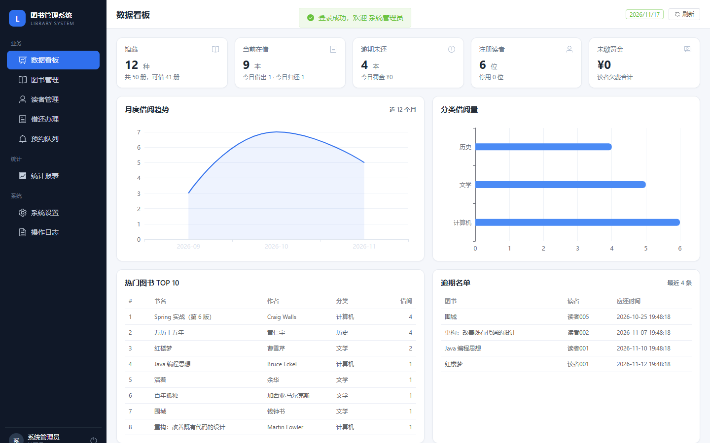
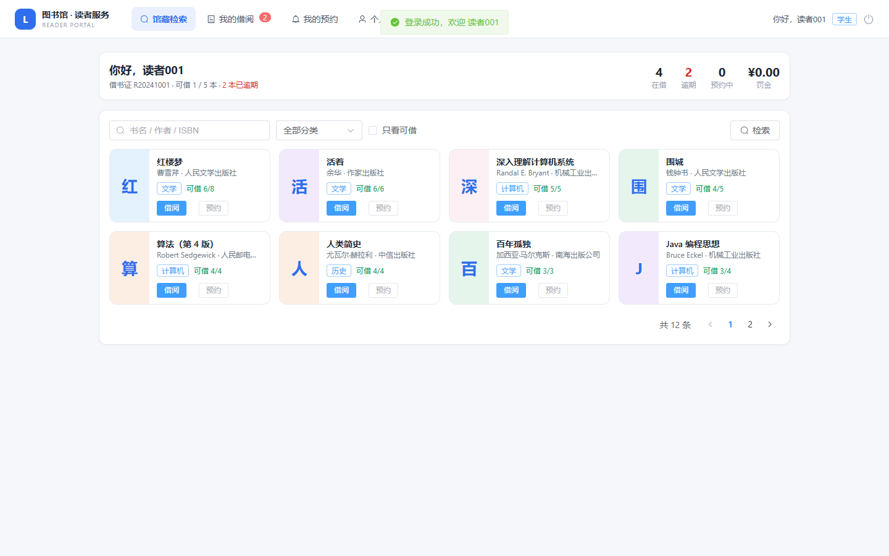
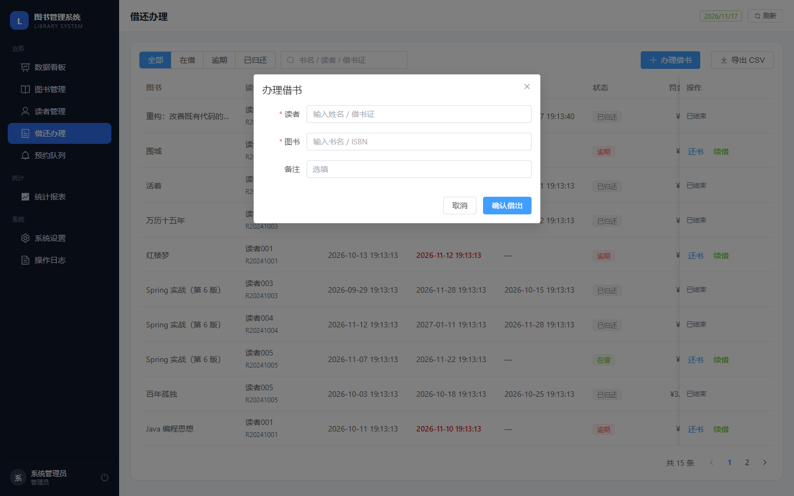
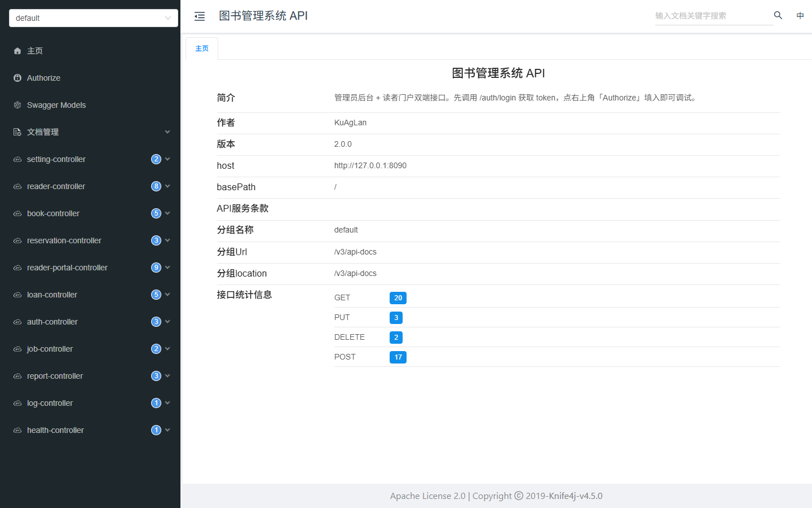

<div align="center">

# 图书管理系统 · LibrarySystem

**馆藏 · 读者 · 借还 · 续借 · 逾期罚金 · 预约排队 · 统计报表**

Spring Boot 3 + Vue 3 + MySQL 8 ｜ 前后端分离 ｜ 管理员后台 + 读者门户


[功能](#-功能) · [截图](#-界面截图) · [架构](#-架构) · [快速开始](#-快速开始) · [技术栈](#-技术栈) · [文档](#-文档)

</div>

---

## ✨ 功能

- **馆藏**：ISBN 唯一、馆藏数 / 可借数分离、上下架、软删除（有在借则拒绝）
- **读者**：借书证自动生成、学生 / 教师 / 社会三类、停用启用、欠费与在借数、门户密码重置
- **借还**：借书 / 还书 / 续借，五道校验（状态 → 额度 → 逾期 → 欠费 → 库存）
- **防超借**：`UPDATE ... WHERE available_copies > 0` 条件扣减 + 事务，并发只成功一次
- **罚金**：逾期按天计费并封顶，还书自动结算，欠费达阈值自动停用读者
- **预约**：无库存排队，归还按顺序通知队首，有预约时禁止续借
- **双端**：管理员后台（9 页）；读者门户（馆藏检索、**自助借还**、预约、个人中心）
- **权限**：JWT 携带 `role + actor`，接口级 `@PreAuthorize`，读者数据范围限本人
- **报表**：月度趋势、分类占比、热门 TOP10、逾期名单、CSV 导出
- **运维**：分布式锁保护的每日结算任务（MySQL / Redis 双实现）+ 全量操作审计

## 🖼 界面截图

<table>
<tr>
<td width="50%"><br/><sub>管理员 · 数据看板：馆藏、在借、逾期、趋势与热门榜</sub></td>
<td width="50%"><br/><sub>读者门户 · 馆藏检索：可借数、借阅 / 预约一键</sub></td>
</tr>
<tr>
<td width="50%"><br/><sub>借还办理：读者 + 图书远程检索，实时校验额度</sub></td>
<td width="50%"><br/><sub>统计报表：月度趋势、分类占比、逾期与导出</sub></td>
</tr>
</table>

> 更多截图见 [docs/screenshots](docs/screenshots)；演示数据中读者与证件号均为虚构占位。

## 🏗 架构

```
浏览器（管理员后台 /#/dashboard · 读者门户 /#/reader/home）
   │  JSON + JWT（role=ADMIN/READER，actor=STAFF/READER）
   ▼
Spring Boot 3 (:8090)  静态资源(SPA) + REST API
   ├─ SecurityFilterChain → JwtAuthFilter → @PreAuthorize
   ├─ Controller → Service（借阅规则 / 罚金 / 预约联动）
   ├─ DistributedLock（MySQL lock_guard ｜ Redis SET NX PX + Lua）
   └─ AuditService（操作留痕）
   ▼
MySQL 8.0（7 张表）    Redis 5+（可选，分布式锁）
```

## 🚀 快速开始

**环境**：JDK 17+（推荐 21）· Maven 3.9+ · Node 18+ · MySQL 8.0

```bash
# 1) 建库
mysql -uroot -p -e "CREATE DATABASE library_db DEFAULT CHARSET utf8mb4;
CREATE USER 'library_app'@'localhost' IDENTIFIED BY 'library_app_2024';
GRANT ALL ON library_db.* TO 'library_app'@'localhost'; FLUSH PRIVILEGES;"

# 2) 后端（自动建表 + 写入演示数据）
mvn -DskipTests package
java -jar target/library-system.jar          # http://127.0.0.1:8090

# 3) 前端（开发模式，热更新）
cd web && npm install && npm run dev         # http://127.0.0.1:5174
```

生产单 jar：`powershell -File scripts/build-all.ps1`（前端打包 → 拷入静态资源 → 打 jar），产物 `target/library-system.jar` 内置页面。

**默认账号**：管理员 `admin / admin123` · 读者用**借书证号**登录（如 `R20241001 / 123456`）

## 🧰 技术栈

| 后端 | 前端 | 运维 |
| --- | --- | --- |
| Java 21 · Spring Boot 3.3.5 | Vue 3.5（`<script setup>`）· Vite 5 | 单 jar 内置前端 / Nginx 反代 |
| Spring Security 6 + JWT（jjwt 0.12.6） | Element Plus 2.8 · Pinia 2 · Vue Router 4 | MySQL 8.0 · Redis 5+（可选） |
| MyBatis-Plus 3.5.7 · Bean Validation | Axios 1.7 · ECharts 5（SVG 渲染） | 分布式锁 + `@Scheduled` 定时任务 |

## 📚 文档

| 文档 | 内容 |
| --- | --- |
| [docs/PROJECT-INTRO.md](docs/PROJECT-INTRO.md) | 项目介绍 / 演示脚本 / 目录结构 / 技术选型 / 架构图 / 模块说明 / 环境搭建 |
| [docs/LOCKS.md](docs/LOCKS.md) | MySQL / Redis 分布式锁原理、配置切换与实测 |
| [docs/README-full.md](docs/README-full.md) | 完整版说明（两类用户细则、关键实现、常见问题） |
| [docs/tests](docs/tests) | 3 个验收脚本：接口 15 项 · 身份权限 15 项 · 分布式锁 10 项 |

## 📖 接口文档（Knife4j）

启动后访问 **`http://127.0.0.1:8090/doc.html`**：自动扫描 11 个控制器、42 个接口，点右上角 `Authorize` 填入登录返回的 token 即可在线调试（OpenAPI 3 规范，也可导出 JSON 供 Apifox / Postman 导入）。



## 🧪 质量保障

| 类型 | 内容 | 结果 |
| --- | --- | --- |
| 单元测试 | `LoanServiceTest`：额度上限 / 逾期禁借 / 欠费阈值 / 无库存 / 并发抢空 / 罚金封顶 / 重复还书 / 预约占位禁续借（Mockito） | **8 项通过** |
| 集成测试 | `BookStockConcurrencyTest`：10 线程抢最后 1 册，仅 1 成功且库存不为负（真实 MySQL） | **1 项通过** |
| 接口验收 | `docs/tests/api-test.mjs` · `identity-test.mjs` · `lock-test.mjs` | 15 + 15 + 10 项 |
| 持续集成 | GitHub Actions：JDK 21 + MySQL 8 service 跑测试，Node 20 构建前端 | [](https://github.com/KuAgLan/LibrarySystem/actions/workflows/ci.yml) |
| 压测 | autocannon 200 并发：`GET /books` **4,201 req/s / p99 147ms**，详见 [docs/PERFORMANCE.md](docs/PERFORMANCE.md) | — |
## ✅ 已覆盖的关键边界

并发超借 · 借阅上限 · 逾期禁借 · 欠费禁借 · 重复还书 · 重复预约 · 越权访问（读者 / 管理员双向 403）· 未登录 401 · 过期锁抢占 · 并发任务互斥 · 审计留痕

## 📄 License

[MIT](LICENSE)
