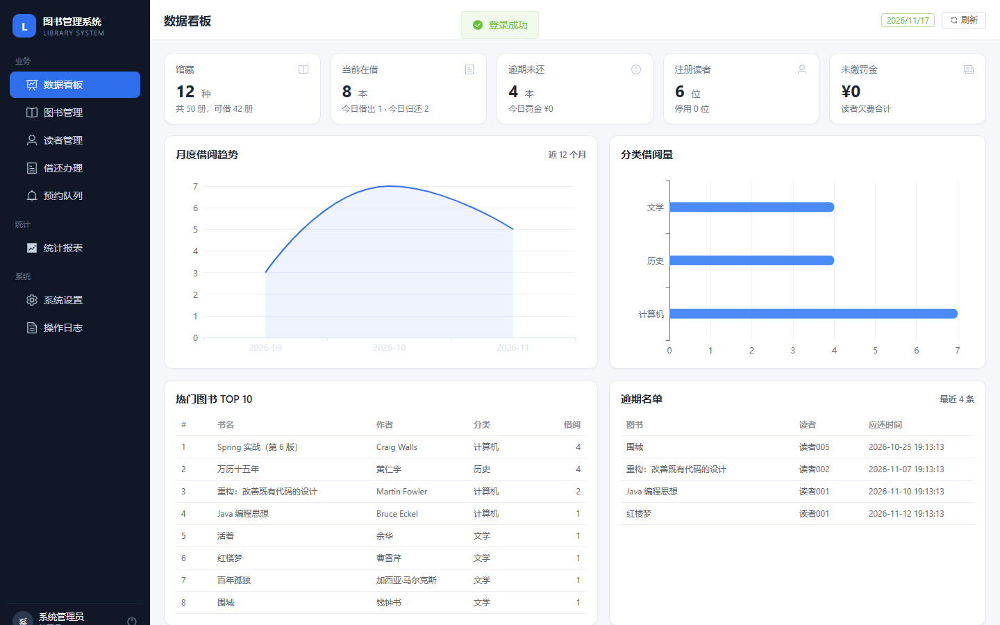
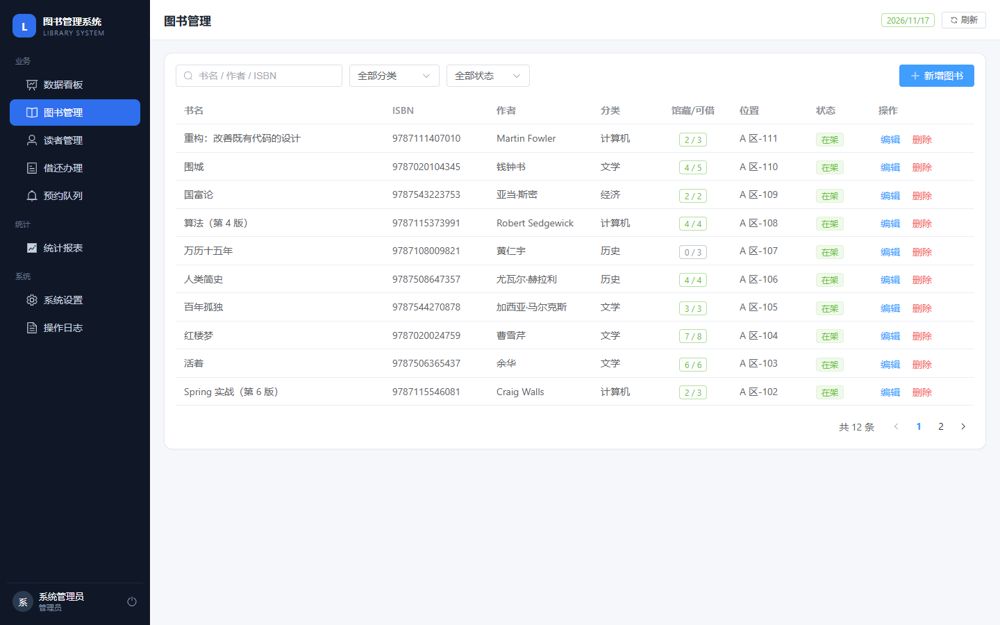
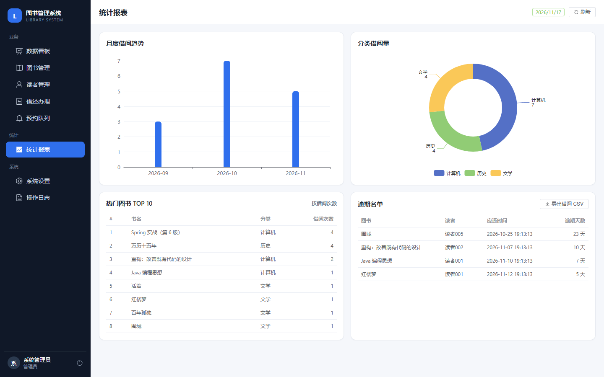

<div align="center">

# 图书管理系统 · LibrarySystem

**图书 · 读者 · 借还 · 预约 · 罚金 · 报表** 一体化图书馆后台

Spring Boot 3 + Vue 3 + MySQL 8 ｜ 前后端分离 ｜ 单 jar 部署


</div>

> **v2.0 已从「Java 控制台 + 原生 JDBC」重写为 Spring Boot 3 + Vue 3 前后端分离架构**，
> 原控制台版本保留在分支 [`legacy-jdbc`](../../tree/legacy-jdbc)。

## ✨ 功能

| 模块 | 能力 |
| --- | --- |
| 图书管理 | 新增 / 编辑 / 软删除、ISBN 唯一校验、馆藏数与可借数分离、上架 / 下架、分类与馆藏位置 |
| 读者管理 | 借书证自动生成、三种类型（学生 / 教师 / 社会）、院系单位、停用 / 启用、欠费与在借数 |
| 借还办理 | 借书 / 还书 / 续借、额度与逾期校验、库存条件更新（防并发超借）、一键导出 CSV |
| 逾期罚金 | 按天计费 + 单本上限、还书自动结算、欠费达阈值自动停用、前台一键收款结清 |
| 预约排队 | 无可借副本时排队、归还后自动通知队首、重复预约拦截、可取消 |
| 统计报表 | 月度借阅趋势、分类借阅量、热门 TOP 10、逾期名单、CSV 导出 |
| 权限 | `ADMIN`（全部）/ `LIBRARIAN`（业务操作），删除与设置仅管理员；接口级 `@PreAuthorize` |
| 审计 | 登录、图书、读者、借还、预约、罚金全量写 `audit_log`，可在「操作日志」检索 |
| 规则配置 | 借期、借阅上限、续借次数与天数、日罚金、罚款上限、欠费禁借阈值，后台可视化配置 |

## 🖼 界面截图

<table>
<tr>
<td width="50%"><br/><sub>数据看板：馆藏、在借、逾期、趋势与热门榜</sub></td>
<td width="50%"><br/><sub>图书管理：检索、馆藏 / 可借、上下架</sub></td>
</tr>
<tr>
<td width="50%"><br/><sub>借还办理：读者 + 图书远程检索，实时校验额度</sub></td>
<td width="50%"><br/><sub>统计报表：月度趋势、分类占比、逾期与导出</sub></td>
</tr>
</table>

## 🏗 架构

```
浏览器 ──▶ Spring Boot 3（:8090）
            ├─ 静态资源：内置 Vue3 打包产物（SPA，History 回退）
            ├─ REST API：/auth /books /readers /loans /reservations /reports /settings /logs
            ├─ JWT 鉴权（HS256，12h）+ @PreAuthorize + 操作人审计
            └─ MySQL 8.0：book / reader / loan / reservation / audit_log / sys_user / setting
```

分层：`Controller`（参数校验 + 权限）→ `Service`（借阅规则、罚金、预约联动）→ `Mapper`（MyBatis-Plus + 统计 SQL）→ MySQL。

## 🚀 快速开始

**环境**：JDK 17+（推荐 21）· Maven 3.9+ · Node 18+ · MySQL 8.0

```bash
# 1) 建库
mysql -uroot -p -e "CREATE DATABASE library_db DEFAULT CHARSET utf8mb4;
CREATE USER 'library_app'@'localhost' IDENTIFIED BY 'library_app_2024';
GRANT ALL ON library_db.* TO 'library_app'@'localhost'; FLUSH PRIVILEGES;"

# 2) 后端（自动建表 + 写入演示数据）
mvn -DskipTests package
java -jar target/library-system.jar          # http://127.0.0.1:8090

# 3) 前端（开发模式，热更新）
cd web && npm install && npm run dev         # http://127.0.0.1:5174
```

**生产单 jar**：`powershell -File scripts/build-all.ps1`（前端打包 → 拷入静态资源 → 打 jar），产物 `target/library-system.jar` 内置页面，直接访问 `http://127.0.0.1:8090`。

**默认账号**：`admin / admin123`（管理员）· `librarian / lib123456`（馆员）

## 🧪 验收

```bash
node docs/tests/api-test.mjs http://127.0.0.1:8090
```

覆盖：登录与错误密码、未授权拦截、借书扣库存、续借上限、重复还书、库存回滚、404、看板聚合、馆员越权删除。当前 **15 项全部通过**。


## 👥 两类用户：管理员 / 读者

前后端分离，同一套 API 由 JWT 中的 `role`（ADMIN / READER）与 `actor`（STAFF / READER）区分身份，登录后自动进入各自的入口。

| | 管理员（ADMIN） | 读者（READER） |
| --- | --- | --- |
| 登录方式 | `sys_user.username` + 密码 | **借书证号** + 门户密码（默认 `123456`） |
| 入口 | `/#/dashboard` 后台（9 个页面） | `/#/reader/home` 读者门户（4 个页面） |
| 图书 | 增删改、上下架、馆藏数调整 | 检索馆藏（仅公开字段）、查看可借数 |
| 读者 | 建档、停用、缴罚金、重置门户密码 | 查看本人资料与额度 |
| 借还 | 代为办理任意读者借还 | **自助借书 / 续借**（本人） |
| 预约 | 查看队列、取消 | 自助预约、取消 |
| 读者数据范围 | 全部 | **仅本人**（越权返回 403/404） |
| 报表 / 设置 / 日志 / 任务 | 可用 | 全部 403 |

接口分工：

```text
/auth/login          两类用户共用入口，返回 role + actor
/auth/me             返回当前身份（含读者类型、罚金）
/reader/**           读者门户，@PreAuthorize("hasRole('READER')")
/books /readers /loans /reservations /reports /settings /logs /admin/**
                     管理端，类级 @PreAuthorize("hasRole('ADMIN')")
```

读者门户页面：**馆藏检索**（卡片式，带可借数与逾期角标）、**我的借阅**（续借）、**我的预约**、**个人中心**（额度、罚金、改密）。

验证脚本 `docs/tests/identity-test.mjs`（15 项全绿）：

```text
✅ 管理员登录 / 读者借书证登录（role=READER）
✅ 读者自助借书、续借、预约；列表只含本人数据
✅ 读者无法操作他人借阅（404）
✅ 读者访问 8 个管理端接口全部 403
✅ 管理员访问读者门户 403 / 未登录 401
```


## 🔒 分布式锁（多实例只跑一次）

定时任务（每日结算）在多实例部署时会重复执行，用分布式锁兜底，两套实现可切换：

| 实现 | 依赖 | 原理 | 启用方式 |
| --- | --- | --- | --- |
| **MySQL**（默认） | 仅需数据库 | `lock_guard` 表主键唯一约束；`INSERT` 抢占，冲突时 `UPDATE ... WHERE expire_at < NOW(3)` 抢占过期锁；释放校验 owner | `app.lock.provider=mysql` |
| **Redis** | Redis 6+ | `SET key owner NX PX ttl` 获取；Lua 脚本校验 owner 后 `DEL` / `PEXPIRE` | `app.lock.provider=redis` |

```sql
CREATE TABLE lock_guard (
  lock_name VARCHAR(64) PRIMARY KEY,
  owner     VARCHAR(64) NOT NULL,   -- 持有者标识（UUID）
  expire_at DATETIME(3) NOT NULL    -- 租约到期，持有者崩溃后自动可抢占
);
```

- 租约 TTL 默认 60s（`app.lock.ttl-seconds`），持有者异常退出后锁自动过期，不会死锁
- 看门狗续租：任务执行期间按 1/3 TTL 后台续租，长任务不会被误抢占
- 释放校验 owner：只允许持有者释放，避免过期后误删别人的锁
- 管理接口：`POST /admin/jobs/settle`（含 `holdMs` 并发演练参数）、`GET /admin/jobs/locks`；系统设置页提供「立即执行 / 并发演练」按钮

安装与切换细节见 **[docs/LOCKS.md](docs/LOCKS.md)**（含 Windows / Linux / Docker 安装、LOCK_PROVIDER 切换、Redis 实测 8 项）。

验证脚本 `docs/tests/lock-test.mjs`（10 项全绿）：

```text
✅ 并发 4 个请求只有 1 个执行 — 成功 1 次，被锁拒绝 3 次
✅ 其余请求返回 409 且提示锁被占用
✅ 并发结束后锁已释放 / 任务执行写入审计日志
✅ 过期锁（模拟宕机遗留）被正常抢占，任务继续执行
```
## 🔧 关键实现

- **防并发超借**：`UPDATE book SET available_copies = available_copies - 1 WHERE id = ? AND available_copies > 0`，受影响行数为 0 即拒绝，配合事务保证账实一致
- **罚金计算**：逾期天数向上取整 × 日罚金，封顶单本上限；还书时一次结算并累计到读者欠费
- **借阅校验链**：读者启用 → 未达借阅上限 → 无逾期未还 → 欠费低于阈值 → 图书在架且有可借副本
- **预约联动**：归还时把队首预约置为 `NOTIFIED`；有预约排队时禁止续借
- **管理端实时性**：借阅规则存 `setting` 表，修改后对新借阅立即生效，无需重启

## 📁 目录

```
src/main/java/com/library/
├─ common/      R · BizException · GlobalExceptionHandler · PageVO
├─ config/      SecurityConfig · JwtUtil · JwtAuthFilter · MybatisPlusConfig · JacksonConfig · WebConfig
├─ entity/      SysUser · Book · Reader · Loan · Reservation · AuditLog · Setting
├─ mapper/      BaseMapper + BookMapper/ReaderMapper/LoanMapper（条件更新与联表统计）+ ReportMapper
├─ service/     Auth · Book · Reader · Loan · Reservation · Report · Setting · Audit · DataSeeder
├─ controller/  Auth · Book · Reader · Loan · Reservation · Report · Setting · Log · Health
└─ vo/ dto/     LoanVO · ReservationVO + 请求体（Bean Validation）
web/src/        api · stores · router · layouts · components · views（9 个页面）
docs/           tests/api-test.mjs · screenshots/
scripts/        build-all.ps1（一键构建单 jar）
```

## ⚠️ 说明

演示数据（`读者001`、`138000000xx`、书名作者）均为公开出版物信息与虚构读者，可直接公开使用。生产部署请替换 `JWT_SECRET`、数据库账号密码，并按需关闭演示数据（`SEED_DEMO_DATA=false`）。

## 📄 License

[MIT](LICENSE)
