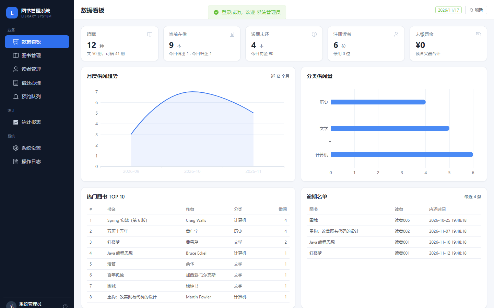
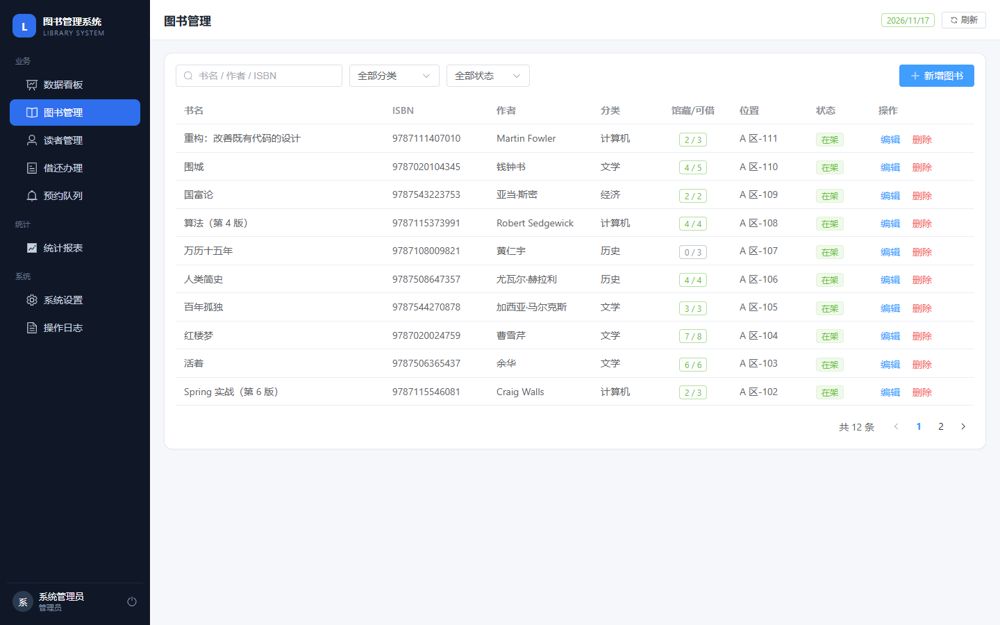
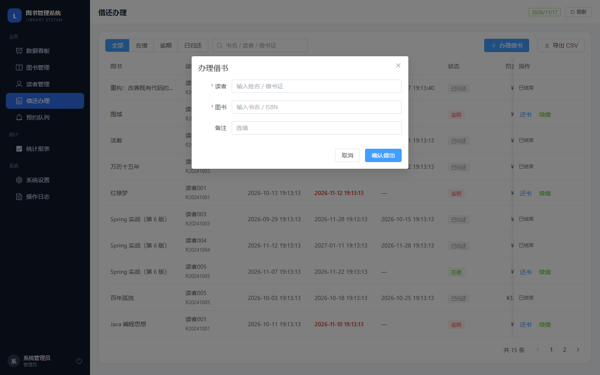
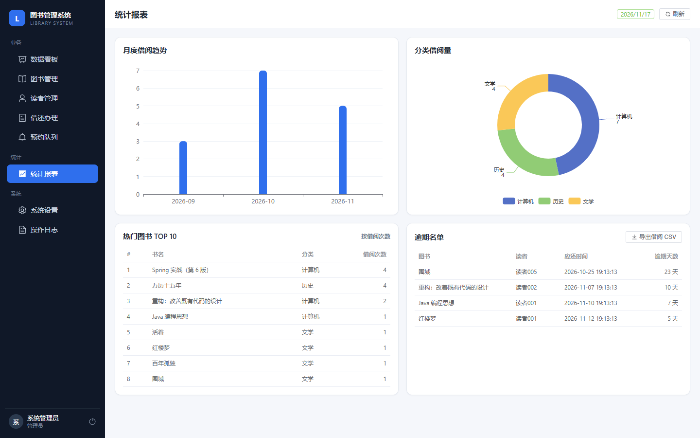
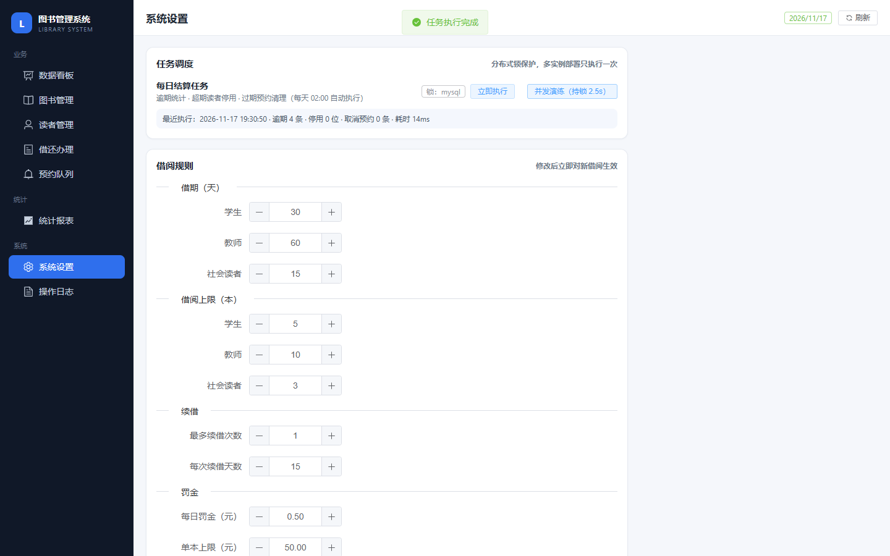
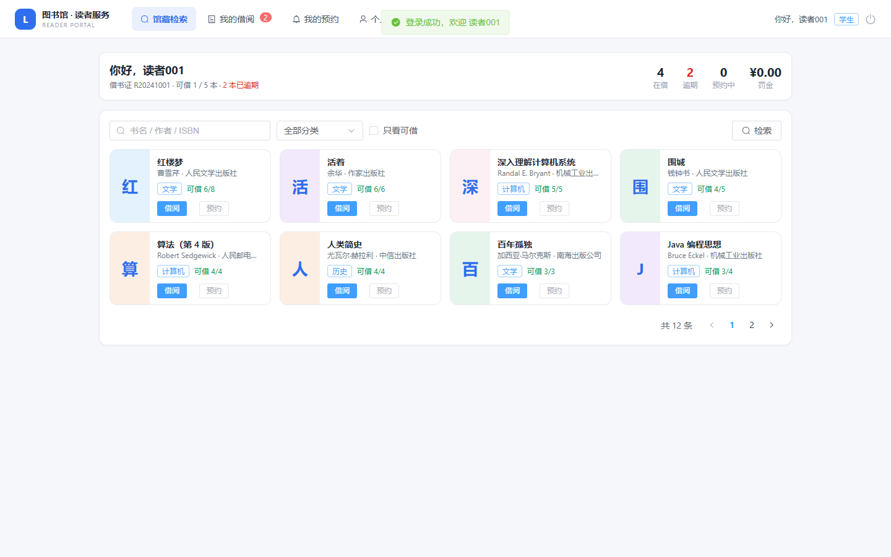
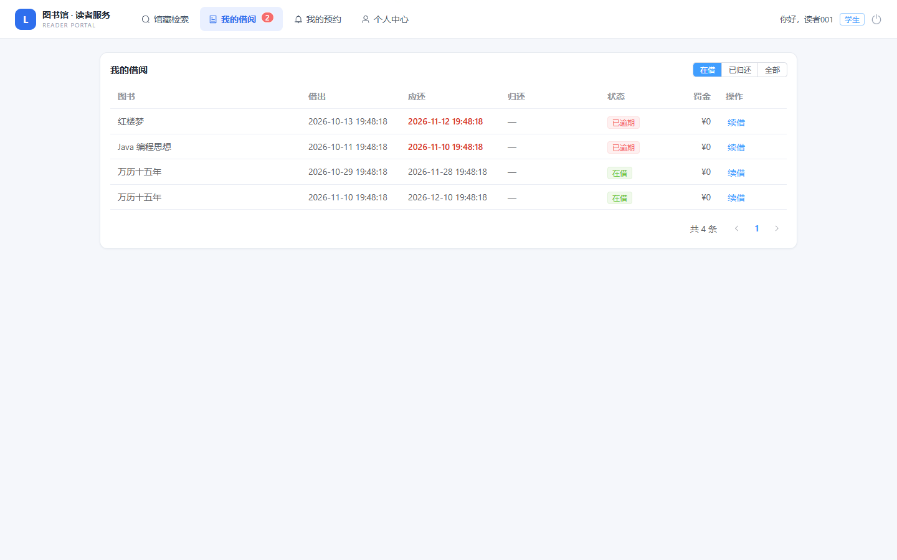
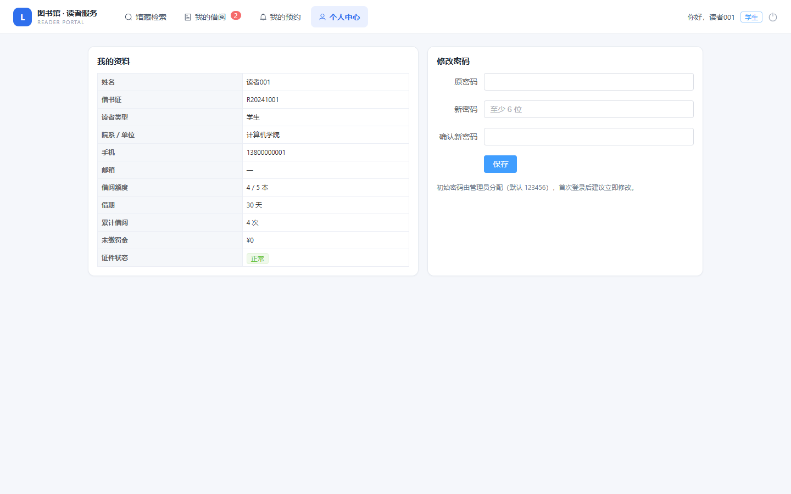

# 图书管理系统 · 项目说明

> Spring Boot 3 + Vue 3 + MySQL 8 ｜ 前后端分离 ｜ 管理员后台 + 读者门户双端

---

## 目录

1. [项目介绍](#1-项目介绍)
2. [项目演示](#2-项目演示)
3. [项目结构](#3-项目结构)
4. [技术选型](#4-技术选型)
5. [架构图](#5-架构图)
6. [模块介绍](#6-模块介绍)
7. [环境搭建](#7-环境搭建)

---

## 1. 项目介绍

### 1.1 是什么

一套面向高校 / 公共图书馆的**图书借阅管理系统**，覆盖「馆藏维护 → 读者办证 → 借书 → 续借 → 归还 → 逾期罚金 → 预约排队 → 统计分析」的完整闭环。

系统采用**前后端分离**架构，面向**两类用户**：

- **管理员**：维护图书与读者、代办理借还、配置借阅规则、查看报表与操作日志、触发结算任务
- **读者**：用借书证号登录门户，检索馆藏、**自助借书 / 续借**、预约缺书、查看本人借阅与罚金

### 1.2 解决什么问题

| 传统做法 | 本项目 |
| --- | --- |
| 借还靠纸质台账，逾期靠人工翻日期 | 借出即算应还日期，逾期天数与罚金自动结算，欠费达阈值自动停用 |
| 借阅额度靠记忆，「谁还能借几本」说不清 | 按读者类型配置借期与上限，借书前五道校验（状态/额度/逾期/欠费/库存） |
| 热门书被借空后读者反复问 | 预约排队，归还时按顺序通知队首；有预约时禁止续借 |
| 读者只能到馆问「我借了什么」 | 读者门户随时查本人借阅、续借、预约、罚金 |
| 并发同时借最后一本会超借 | `UPDATE ... WHERE available_copies > 0` 条件扣减 + 事务，账实一致 |
| 月底盘点靠翻台账 | 月度趋势、分类占比、热门 TOP10、逾期名单、CSV 导出 |
| 谁改了数据查不到 | 登录/图书/读者/借还/预约/罚金/任务全量写审计日志 |
| 多实例部署定时任务重复执行 | MySQL / Redis 双实现分布式锁，每日结算只跑一次 |

### 1.3 核心能力

- **馆藏**：ISBN 唯一校验、馆藏数 / 可借数分离、上下架、软删除（有在借则拒绝）
- **读者**：借书证自动生成、三类读者（学生 / 教师 / 社会）、停用启用、欠费与在借数、门户密码重置
- **借还**：借书 / 还书 / 续借，逾期罚金按天计费并封顶，还书自动结算
- **预约**：无库存排队、归还通知队首、重复预约拦截、可取消
- **规则**：借期、借阅上限、续借次数与天数、日罚金、罚金上限、欠费禁借阈值，后台可视化配置，即时生效
- **报表**：月度借阅趋势、分类借阅量、热门图书 TOP10、逾期名单、借阅 CSV 导出
- **权限**：`ADMIN` / `READER` 双角色，JWT 携带 `role + actor`，接口级 `@PreAuthorize`，读者数据范围限本人
- **运维**：健康检查、审计日志、分布式锁保护的定时结算任务

### 1.4 适用场景

高校图书馆 / 中小学图书室 / 社区与公共图书馆的借阅管理；也适合作为 Spring Boot 3 + Vue 3 全栈教学与二次开发基座（含完整权限矩阵、并发控制、分布式锁与自动化验收脚本）。

> 演示数据中的读者、借书证号、手机号均为虚构占位，图书信息为公开出版物，可直接公开。

---

## 2. 项目演示

### 2.1 演示环境

| 项 | 值 |
| --- | --- |
| 访问地址 | `http://127.0.0.1:8090`（单 jar 内置前端）· 开发模式 `http://127.0.0.1:5174` |
| 管理员 | `admin / admin123` |
| 读者 | 借书证号 + 密码，如 `R20241001 / 123456`（新建读者默认密码 `123456`） |
| 演示数据 | 12 种图书 / 50 册、6 位读者、14 条借阅（含逾期）、三档借阅规则 |

### 2.2 界面截图

**登录（管理员与读者共用入口）**


**管理员 · 数据看板**（馆藏、在借、逾期、趋势、热门榜、逾期名单）



**管理员 · 图书管理**（检索、馆藏 / 可借、上下架）



**管理员 · 借还办理**（远程检索读者与图书，实时校验额度）



**管理员 · 统计报表**（月度趋势、分类占比、热门 TOP10、逾期名单与导出）



**管理员 · 系统设置 + 任务调度**（借阅规则可视化配置，分布式锁保护的任务可手动触发）



**读者门户 · 馆藏检索**（卡片式，可借数与逾期角标，一键借阅 / 预约）



**读者门户 · 我的借阅 / 个人中心**





### 2.3 演示脚本（5 分钟走完主流程）

1. `admin` 登录 → 图书管理新增一本书（ISBN、馆藏数 3）
2. 读者管理登记一位读者 → 记住自动生成的借书证号
3. 借还办理 → 选择该读者与新书 → 借出（应还日期按读者类型自动计算）
4. 同一读者再借到额度上限 → 出现「已达借阅上限」提示
5. 换一位有逾期记录的读者借书 → 提示「有 N 本逾期未还，请先归还」
6. 还书 → 逾期记录自动结算罚金；欠费达阈值读者自动停用
7. 系统设置 → 调整日罚金 / 借期 → 再借书验证规则即时生效
8. 用读者账号登录 → 门户检索 → **自助借书 / 续借** → 查我的借阅与罚金
9. 读者强行访问 `#/books` → 自动弹回门户首页（权限隔离）

---

## 3. 项目结构

```
LibrarySystem/
├─ pom.xml                          # Spring Boot 3.3.5 / JDK 21 / 单模块
├─ src/main/java/com/library/
│  ├─ LibraryApplication.java       # 入口（@EnableScheduling + @MapperScan）
│  ├─ common/    (4)                # R · BizException · GlobalExceptionHandler · PageVO
│  ├─ config/    (7)                # SecurityConfig · JwtUtil · JwtAuthFilter · AuthUser
│  │                                # MybatisPlusConfig · JacksonConfig · WebConfig(SPA 回退)
│  ├─ entity/    (7)                # SysUser · Book · Reader · Loan · Reservation · AuditLog · Setting
│  ├─ mapper/    (8)                # BaseMapper + 条件更新 / 联表分页 / 报表聚合
│  ├─ service/   (12)               # Auth · Book · Reader · Loan · Reservation · Report
│  │                                # Setting · Audit · DataSeeder · NightlySettle · Job · ReaderPortal
│  ├─ controller/ (11)              # Auth · Book · Reader · Loan · Reservation · Report
│  │                                # Setting · Log · Job · ReaderPortal · Health
│  ├─ lock/      (3)                # DistributedLock · MysqlLock · RedisLock
│  ├─ job/       (1)                # NightlySettleJob（@Scheduled + 分布式锁）
│  ├─ dto/ vo/   (9)                # 请求体（Bean Validation）+ LoanVO / ReservationVO
│  └─ resources/
│     ├─ application.yml            # 数据源、JWT、锁、任务、规则默认值
│     └─ db/schema.sql              # 建表（幂等，服务启动自动执行）
├─ web/                             # Vue 3 前端
│  ├─ vite.config.js  index.html  package.json
│  └─ src/
│     ├─ api/       http.js（鉴权 / 401 / 统一错误）、index.js（9 组接口）
│     ├─ stores/    auth.js（token、角色、readerType、homePath）
│     ├─ router/    index.js（管理端 9 页 + 读者端 4 页，按角色守卫）
│     ├─ layouts/   MainLayout.vue（管理端侧栏）· ReaderLayout.vue（读者门户顶部导航）
│     ├─ components/StatCard.vue · EChart.vue（ECharts SVG 封装）
│     └─ views/     9 个管理端页面 + reader/ 4 个读者页面
├─ docs/
│  ├─ PROJECT-INTRO.md（本文）  LOCKS.md（分布式锁）
│  ├─ screenshots/  11 张演示截图
│  └─ tests/        api-test.mjs · identity-test.mjs · lock-test.mjs
├─ scripts/build-all.ps1            # 前端打包 → 拷入静态资源 → 打可执行 jar
├─ .env.example  .gitignore  LICENSE  README.md
```

**规模**：Java **63 个文件 / 2,840 行**；Vue **18 个文件 / 1,537 行**；后端 11 个控制器、48 个 REST 接口。

---

## 4. 技术选型

### 4.1 后端

| 层次 | 选型 | 版本 | 说明 |
| --- | --- | --- | --- |
| 语言 / 运行时 | Java LTS | 21（最低 17） | record、文本块、switch 表达式 |
| 框架 | Spring Boot | 3.3.5 | 内嵌 Tomcat、自动配置、`@Scheduled` |
| 安全 | Spring Security 6 + JWT（jjwt） | 0.12.6 | 无状态鉴权；`role + actor` 双声明；`@PreAuthorize` 方法级授权 |
| 持久层 | MyBatis-Plus | 3.5.7 | BaseMapper 免样板、分页插件、逻辑删除；复杂统计用注解 SQL |
| 数据库 | MySQL | 8.0 | InnoDB / utf8mb4；金额 `DECIMAL(10,2)`；唯一键与索引 |
| 校验 | Jakarta Bean Validation | — | DTO 声明式校验 + 统一异常出口 |
| 缓存 / 锁 | Redis（可选） | 5+ | 分布式锁第二实现；不装也能跑（默认 MySQL 锁） |
| 构建 | Maven | 3.9 | 单模块，`spring-boot-maven-plugin` 打可执行 jar |

**为什么不用消息队列 / 注册中心**：单体业务量级下（单库单服务）引入 MQ、注册中心只会增加运维成本；任务调度用 `@Scheduled` + 分布式锁即可满足多实例安全，需要水平扩展时可直接复制实例部署。

### 4.2 前端

| 层次 | 选型 | 版本 | 说明 |
| --- | --- | --- | --- |
| 框架 | Vue 3（`<script setup>`） | 3.5 | 组合式 API |
| 构建 | Vite | 5.4 | 秒级热更新；`server.proxy` 直连 8090 |
| UI 组件库 | Element Plus | 2.8 | 表格 / 表单 / 弹窗 / 分页 / 描述列表，中文语言包 |
| 状态管理 | Pinia | 2.2 | 登录态、角色、借书证、首页路径 |
| 路由 | Vue Router | 4.4 | Hash 模式 + `meta.roles` 守卫（管理端 / 读者端分流） |
| HTTP | Axios | 1.7 | 拦截器注入 `Authorization`，401 自动登出，统一错误提示 |
| 图表 | ECharts | 5.5 | **SVG 渲染**（无 canvas 依赖） |
| 样式 | 原生 CSS + 变量 | — | 管理端深色侧栏、读者端浅色顶栏，`auto-fill` 卡片网格自适应 |

**权限模型**：登录响应返回 `role`（ADMIN / READER）与 `actor`（STAFF / READER），前端据此选择布局与首页；路由守卫拦截越权访问，后端接口再做一次 `@PreAuthorize` 校验（双层防护）。

### 4.3 部署与运维

| 组件 | 用途 |
| --- | --- |
| 单 jar | 前端产物打进 `src/main/resources/static`，一个进程同时提供页面与 API |
| Nginx（可选） | 反向代理 + gzip + 静态缓存；`/api` 与 SPA 回退 |
| 健康检查 | `/health`；`GET /admin/jobs/locks` 查看任务锁占用 |
| 审计 | `audit_log` 表 + 管理端「操作日志」页检索 |

---

## 5. 架构图

### 5.1 总体架构

```
         ┌──────────────── 浏览器 ────────────────┐
         │  管理员后台 /#/dashboard（9 页）        │
         │  读者门户  /#/reader/home（4 页）       │
         └───────────────┬────────────────────────┘
                         │ HTTPS / JSON（JWT: role + actor）
                 ┌───────▼────────────────────────────────┐
                 │        Spring Boot 3  (:8090)          │
                 │  静态资源（Vue3 SPA，History 回退）      │
                 │  SecurityFilterChain → JwtAuthFilter   │
                 │        ↓                               │
                 │  @PreAuthorize  ADMIN / READER         │
                 │        ↓                               │
                 │  Controller → Service → Mapper         │
                 │        ├─ SettingService（借阅规则）    │
                 │        ├─ DistributedLock（MySQL/Redis）│
                 │        └─ AuditService（操作留痕）      │
                 └───────┬────────────────────────────────┘
                         │
                 ┌───────▼────────┐        ┌──────────────────┐
                 │   MySQL 8.0    │        │  Redis 5+（可选） │
                 │  7 张业务表     │        │  分布式锁          │
                 └────────────────┘        └──────────────────┘
```

### 5.2 分层结构

```
Controller（REST + 参数校验 + @PreAuthorize）
     ↓
Service（业务规则：额度 / 逾期 / 罚金 / 预约联动 / 规则读取）
     ↓
Mapper（MyBatis-Plus BaseMapper + 条件更新 + 联表分页 + 报表聚合）
     ↓
MySQL（InnoDB，逻辑删除，金额 DECIMAL）
```

### 5.3 关键流程

**① 借书（管理员代借 / 读者自助，同一套校验）**

```
请求（bookId + readerId 或令牌中的 readerId）
  ├─ 读者存在且 ACTIVE                → 否则 403/404
  ├─ 在借数 < 类型上限                 → 否则「已达借阅上限」
  ├─ 无逾期未还                        → 否则「有 N 本逾期」
  ├─ 未缴罚金 < 阈值                   → 否则「请先缴纳」
  ├─ 图书在架                          → 否则「已下架」
  ├─ UPDATE book SET available_copies = available_copies - 1
  │     WHERE id = ? AND available_copies > 0   ← 并发安全（影响 0 行即拒绝）
  ├─ 写 loan（due_at = now + 借期天数）
  ├─ 读者在借数 +1 / 累计 +1
  └─ 审计 LOAN_BORROW
```

**② 还书**

```
POST /loans/{id}/return
  ├─ 逾期天数 = ceil((now − due_at) / 1 天)
  ├─ 罚金 = min(天数 × 日罚金, 单本上限)
  ├─ loan → RETURNED（记录归还时间与罚金）
  ├─ 库存 +1、读者在借数 −1
  ├─ 罚金累计到读者欠费；欠费 ≥ 阈值 → 读者 SUSPENDED
  ├─ 若有预约 → 队首置为 NOTIFIED（通知取书）
  └─ 审计 LOAN_RETURN
```

**③ 每日结算任务（分布式锁）**

```
@Scheduled(cron=02:00)  →  JobService.runNightlySettle()
  ├─ tryLock("job:nightly-settle", 60s)
  │     MySQL：INSERT lock_guard / UPDATE 抢占过期锁
  │     Redis：SET NX PX + Lua 释放
  ├─ 看门狗线程按 1/3 TTL 续租
  ├─ 统计逾期 → 逾期 ≥30 天或欠费达阈值读者停用
  ├─ 「待取书」超 3 天预约自动取消
  ├─ 写审计 JOB_NIGHTLY_SETTLE
  └─ finally unlock（仅 owner 可释放）
```

### 5.4 身份与权限流

```
POST /auth/login
  ├─ 查 sys_user(username) 密码匹配 → role=ADMIN, actor=STAFF
  └─ 查 reader(card_no)    密码匹配 → role=READER, actor=READER
        ↓
  JWT{sub, username, name, role, actor, exp(12h)}
        ↓
  /reader/**       → @PreAuthorize("hasRole('READER')")  数据限本人
  /books /readers /loans /reservations /reports /settings /logs /admin/**
                   → @PreAuthorize("hasRole('ADMIN')")
```

---

## 6. 模块介绍

### 6.1 后端模块

| 包 | 职责 | 关键实现 |
| --- | --- | --- |
| `common` | 统一响应 `{ok,data,error}`、业务异常、全局异常处理、分页结构 | `GlobalExceptionHandler` 覆盖校验/类型/权限/404/500 |
| `config` | 安全链、JWT、当前用户、MP 分页、时间序列化、SPA 回退 | 无状态 + StatelessSession；401/403 返回统一 JSON |
| `entity` / `mapper` | 7 张表实体与 DAO | `BookMapper.decreaseAvailable`（条件扣减）、`LoanMapper.selectVoPage`（联表分页） |
| `service` | 12 个业务服务 | 见下表 |
| `controller` | 11 个 REST 控制器，48 个接口 | 管理端 8 个 + 读者端 1 个 + 认证 + 健康检查 |
| `lock` | 分布式锁抽象与两套实现 | MySQL 表锁 / Redis Lua |
| `job` | 定时任务 | 每日结算（默认 02:00，cron 可配） |

| 服务 | 职责 |
| --- | --- |
| `AuthService` | 双身份登录、失败限流（5 次 / 10 分钟）、改密 |
| `BookService` | 图书 CRUD、ISBN 唯一、馆藏调整（不得小于在借数）、删除保护 |
| `ReaderService` | 读者 CRUD、借书证生成、状态切换、缴罚金、重置门户密码 |
| `LoanService` | 借书 / 还书 / 续借、罚金结算、预约联动 |
| `ReservationService` | 管理员侧预约队列查询与取消 |
| `ReaderPortalService` | 读者自助：检索、借书、续借、预约、资料 |
| `SettingService` | 规则读写（借期 / 上限 / 续借 / 罚金 / 禁借阈值），带默认值兜底 |
| `ReportService` | 看板聚合与借阅 CSV 导出 |
| `AuditService` | 当前登录人解析 + 审计落库（含 IP） |
| `DataSeeder` | 首次启动初始化账号 / 图书 / 读者 / 借阅演示数据 |
| `NightlySettleService` | 逾期统计、读者停用、过期预约清理 |
| `JobService` | 任务加锁编排 + 看门狗续租 |

### 6.2 前端页面

| 端 | 页面 | 路由 | 说明 |
| --- | --- | --- | --- |
| 公共 | 登录 | `/#/login` | 管理员账号或借书证号登录，按角色跳转 |
| 管理端 | 数据看板 | `/#/dashboard` | 5 张指标卡 + 趋势图 + 分类图 + 热门榜 + 逾期名单 |
| | 图书管理 | `/#/books` | 检索、分类 / 状态筛选、新增编辑、删除 |
| | 读者管理 | `/#/readers` | 检索、登记、停用、缴罚金、重置门户密码 |
| | 借还办理 | `/#/loans` | 在借 / 逾期 / 已归还切换、办理借书、还书、续借、导出 |
| | 预约队列 | `/#/reservations` | 排队中 / 待取书 / 全部，取消预约 |
| | 统计报表 | `/#/reports` | 趋势柱状图、分类饼图、热门榜、逾期名单、CSV |
| | 系统设置 | `/#/settings` | 借阅规则表单 + 任务调度卡片（管理员可见） |
| | 操作日志 | `/#/logs` | 审计检索（仅管理员） |
| 读者端 | 馆藏检索 | `/#/reader/home` | 卡片网格、可借数、借阅 / 预约、逾期角标 |
| | 我的借阅 | `/#/reader/loans` | 在借 / 已归还、逾期高亮、续借 |
| | 我的预约 | `/#/reader/reservations` | 排队状态、取消 |
| | 个人中心 | `/#/reader/profile` | 资料、额度、罚金、修改密码 |

### 6.3 数据模型

| 表 | 说明 | 关键字段 / 约束 |
| --- | --- | --- |
| `sys_user` | 管理员账号 | `username` 唯一、`role`、BCrypt 密码 |
| `reader` | 读者 | `card_no` 唯一、`type`、`unpaid_fine`、`borrowed_now`、`password` |
| `book` | 图书 | `isbn` 唯一、`total_copies` / `available_copies`、`status`、逻辑删除 |
| `loan` | 借阅记录 | `due_at`、`returned_at`、`renew_count`、`fine_amount`、`status` |
| `reservation` | 预约队列 | `status`（WAITING/NOTIFIED/FULFILLED/CANCELLED） |
| `audit_log` | 操作审计 | 操作人、动作、对象、详情、IP |
| `lock_guard` | 分布式锁（MySQL 实现） | `lock_name` 主键、`owner`、`expire_at` |
| `setting` | 系统设置 | `k` 唯一，存借阅规则 |

### 6.4 接口一览（节选）

| 端 | 方法 | 路径 | 说明 |
| --- | --- | --- | --- |
| 公共 | POST | `/auth/login` | 管理员 / 读者登录 |
| | GET | `/auth/me` | 当前身份 |
| | POST | `/auth/password` | 修改本人密码 |
| 管理 | GET/POST/PUT/DELETE | `/books`、`/books/{id}` | 图书管理 |
| | GET/POST/PUT/DELETE | `/readers`、`/readers/{id}` | 读者管理 |
| | POST | `/readers/{id}/status`、`/pay-fine`、`/reset-password` | 状态 / 收款 / 重置密码 |
| | GET/POST | `/loans`、`/loans/borrow`、`/loans/{id}/return`、`/loans/{id}/renew` | 借还 |
| | GET/POST | `/reservations`、`/reservations/{id}/cancel` | 预约 |
| | GET | `/reports/dashboard`、`/reports/loans/export` | 报表与导出 |
| | GET/PUT | `/settings` | 规则读写 |
| | GET | `/logs` | 审计（管理员） |
| | POST/GET | `/admin/jobs/settle`、`/admin/jobs/locks` | 任务触发 / 锁状态 |
| 读者 | GET | `/reader/profile`、`/reader/books`、`/reader/loans`、`/reader/reservations`、`/reader/fine` | 门户查询 |
| | POST | `/reader/loans/borrow`、`/reader/loans/{id}/renew`、`/reader/books/{id}/reserve`、`/reader/reservations/{id}/cancel` | 自助操作 |

### 6.5 质量保障

| 类型 | 内容 |
| --- | --- |
| 接口验收 | `docs/tests/api-test.mjs` **15 项**：登录、401、借还、库存回滚、续借上限、重复还书、404、看板 |
| 身份验收 | `docs/tests/identity-test.mjs` **15 项**：双端登录、自助借还、越权 403/404、数据隔离 |
| 锁验收 | `docs/tests/lock-test.mjs` **10 项**：并发互斥、409 提示、锁释放、权限、审计、过期抢占 |
| 浏览器 E2E | Playwright + Edge headless：双端登录跳转、图书卡片、借阅列表、越权弹回，全程收集 console error |
| 已验证边界 | 超额借阅、逾期禁借、欠费禁借、并发超借、重复还书、非法角色、读者越权、未登录 401 |

---

## 7. 环境搭建

### 7.1 开发工具

| 类别 | 推荐 |
| --- | --- |
| IDE | IntelliJ IDEA（后端）、VS Code + Volar（前端） |
| JDK | Temurin / Microsoft OpenJDK **21**（最低 17） |
| 构建 | Maven **3.9+**、Node.js **18+**（推荐 20/22） |
| 数据库 | MySQL 8.0 + DataGrip / Navicat / DBeaver |
| 缓存（可选） | Redis 5+（Windows 便携版 / WSL / Docker） |
| 接口调试 | Postman / Apifox / curl |
| 浏览器调试 | Chrome / Edge DevTools（Network + Console） |
| 版本管理 | Git + GitHub |

### 7.2 开发环境（最低配置）

| 项 | 建议 |
| --- | --- |
| 操作系统 | Windows 10/11、macOS 13+、Linux（Ubuntu 22.04+） |
| CPU / 内存 | 2 核 / 4 GB 起（含 IDE 建议 8–16 GB） |
| 磁盘 | 1 GB 空闲（依赖 + 构建产物） |
| 软件 | JDK 21、Maven 3.9、Node 18+、MySQL 8.0 |
| 端口占用 | 8090（后端）、5174（前端 dev）、3306（MySQL）、6379（Redis，可选） |

### 7.3 启动步骤

**① 数据库**

```sql
CREATE DATABASE library_db DEFAULT CHARACTER SET utf8mb4 COLLATE utf8mb4_general_ci;
CREATE USER 'library_app'@'localhost' IDENTIFIED BY 'library_app_2024';
GRANT ALL PRIVILEGES ON library_db.* TO 'library_app'@'localhost';
FLUSH PRIVILEGES;
```

> 表结构随服务启动自动创建（`src/main/resources/db/schema.sql`，幂等）；演示数据在表为空时写入，可关闭：`SEED_DEMO_DATA=false`。

**② 后端**

```bash
mvn -DskipTests package
java -jar target/library-system.jar          # http://127.0.0.1:8090
# Windows 若报临时目录错误：
# java -Djava.io.tmpdir=./.run/tmp -jar target/library-system.jar
```

**③ 前端（开发模式）**

```bash
cd web
npm install
npm run dev                                   # http://127.0.0.1:5174，/auth /books … 已代理到 8090
```

**④ 单 jar 部署（前端打进后端）**

```powershell
powershell -File scripts/build-all.ps1        # 前端打包 → 拷入 static → mvn package
java -jar target/library-system.jar           # 访问 http://127.0.0.1:8090
```

**⑤ 可选：启用 Redis 分布式锁**

```bash
# Windows 便携版
.tools/redis/redis-server.exe .tools/redis/redis.conf
# Linux：sudo apt install -y redis-server && sudo systemctl enable --now redis-server

LOCK_PROVIDER=redis java -jar target/library-system.jar
```

详见 [LOCKS.md](LOCKS.md)。

### 7.4 配置项

| 配置 | 默认 | 说明 |
| --- | --- | --- |
| `server.port` | 8090 | 后端端口 |
| `spring.datasource.*` | `library_db` / `library_app` | 数据源（可用环境变量覆盖） |
| `JWT_SECRET` | 开发占位值 | **生产必须替换**（≥32 字节） |
| `JWT_EXPIRE_HOURS` | 12 | 令牌有效期 |
| `SEED_DEMO_DATA` | true | 是否写入演示数据 |
| `LOCK_PROVIDER` | mysql | 锁实现：mysql / redis |
| `app.lock.ttl-seconds` | 60 | 锁租约时长 |
| `NIGHTLY_CRON` | `0 0 2 * * ?` | 每日结算执行时间 |

借阅规则（`setting` 表，可在「系统设置」页修改，即时生效）：

| 规则 | 默认 |
| --- | --- |
| 借期（学生 / 教师 / 社会） | 30 / 60 / 15 天 |
| 借阅上限（学生 / 教师 / 社会） | 5 / 10 / 3 本 |
| 续借次数 / 每次天数 | 1 次 / 15 天 |
| 日罚金 / 单本上限 / 欠费禁借阈值 | 0.50 元 / 50 元 / 10 元 |

### 7.5 常见问题

| 现象 | 处理 |
| --- | --- |
| `Communications link failure` | MySQL 未启动或账号密码不对，检查 `application.yml` |
| `Access denied for user 'library_app'` | 未建库账号或未授权，执行 7.3 第①步 |
| 前端 404 / 白屏 | 单 jar 模式确认已执行 `scripts/build-all.ps1`；dev 模式确认 vite 代理端口 8090 |
| 接口 401 | 令牌过期（默认 12h）或 `JWT_SECRET` 变更，重新登录 |
| 读者登录失败 | 借书证号需与数据库中 `card_no` 完全一致；密码默认 `123456`（管理员可重置） |
| 借书提示「已达上限 / 有逾期 / 欠费」 | 业务校验生效，先还书或到服务台缴清罚金 |
| 任务接口 409 | 其它实例正持有锁，稍后重试（`GET /admin/jobs/locks` 查看） |
| 切换 Redis 后任务报错 | Redis 未启动，确认 `redis-cli ping` 返回 PONG |
| Windows `Unable to create tempDir` | 加 `-Djava.io.tmpdir=./.run/tmp` |

---

## 附：可扩展方向

- 读者端消息通知（到期提醒、预约到书短信 / 邮件）
- 图书批量导入（Excel / ISBN 扫码）与馆藏盘点
- 续借在线支付罚金（对接支付渠道）
- 多馆区 / 多分馆与馆际互借
- 电子资源（电子书、论文库）与借阅统计打通
- 报表导出 PDF 与定时月报邮件
